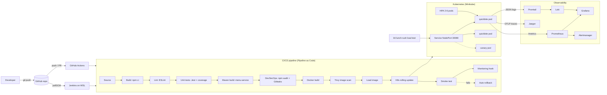

# QuickBite — CI/CD-Driven Deployment and SRE Monitoring of a Campus Canteen Pre-Order Service on Kubernetes

**Course:** PEC 4 – DevOps · **Activity:** FA2 · **Units covered:** III (CI/CD) and IV (Monitoring, Observability, SRE)

## 1. Problem statement
Every day around 1 pm hundreds of students hit the canteen ordering system at once. Orders slow
down or fail, and nobody notices until students complain. Releases are manual, so a bad update can
take the service down during lunch.

**Objective:** build a small canteen pre-order REST API and deliver it through a fully automated
CI/CD pipeline (build → test → security scan → containerize → deploy to Kubernetes), with
end-to-end observability (metrics, logs, traces) and SRE practices (SLIs/SLOs/SLA, error budget,
alerting, incident simulation and a blameless post-mortem).

## 2. Architecture



## 3. Tools and why they were chosen

| Stage | Tool | Syllabus topic |
|---|---|---|
| Source control | Git + GitHub | Build–Test–Deploy loop |
| CI server | **Jenkins** (Jenkinsfile) and **GitHub Actions** (YAML) | Setting up a CI server, Pipeline as Code |
| Build | npm (Node 22), **Maven** (Java menu-service) | Automating compilation, Maven |
| Unit tests | Jest + Supertest (16 tests, ~96% coverage), JUnit 5 | Automating unit testing |
| DevSecOps | npm audit, Gitleaks, Trivy, non-root container, read-only FS | DevSecOps |
| Containerization | Docker (multi-stage, hardened Alpine) | Containers |
| Orchestration | Kubernetes (Minikube / kind), HPA | Kubernetes architecture |
| Deployment strategies | Rolling update (zero downtime), canary, automatic rollback | Continuous Deployment, deployment strategies |
| Metrics | prom-client → Prometheus → Grafana | Metrics and visualization |
| Logs | Structured JSON → Promtail → Loki → Grafana | Centralized logging (ELK or similar) |
| Traces | OpenTelemetry → Jaeger | Three pillars of observability |
| Alerting | PrometheusRule → Alertmanager | Incident management |
| SRE | SLI/SLO/SLA, error budget, runbook, post-mortem | SRE principles |
| Load testing | k6 (SLOs as thresholds) | Reliability testing |

## 4. Rubric mapping

| Rubric | How this project meets "Excellent" |
|---|---|
| **1. Selection of methods, tools and design (3)** | Every stage (source, build, test, containerization, deployment, monitoring) is designed for the lunch-rush requirement, using modern tools: Jenkins + GitHub Actions, Docker, Kubernetes, Prometheus + Grafana (plus Maven, Trivy, Loki, Jaeger, k6). |
| **2. Implementation (5)** | Working end-to-end pipeline: automated build, test, security scan, deploy with rollback, and monitoring with live SLO alerts. |
| **3. Timely submission (2)** | This README, `sre/` documents, dashboard and demo script give complete documentation and a repeatable demo. |

## 5. Folder structure

```
quickbite-devops/
├── app/                      Node.js service (API + simple web page)
│   ├── src/                  app.js, metrics.js, logger.js, tracing.js, store.js, server.js
│   ├── tests/                Jest unit/integration tests
│   ├── public/index.html     Student ordering page
│   └── Dockerfile            Multi-stage, non-root, hardened image
├── menu-service/             Java pricing module built with Maven (pom.xml + JUnit 5)
├── Jenkinsfile               Jenkins declarative pipeline (12 stages + auto rollback)
├── .github/workflows/ci-cd.yml  Same pipeline on GitHub Actions, deploys to a kind cluster
├── k8s/                      namespace, configmap, deployment, service, hpa, canary
├── monitoring/               Prometheus/Grafana values, ServiceMonitor, SLO alert rules,
│                             Grafana dashboard, Loki values, Jaeger
├── load-test/                k6 lunch-rush script (SLOs as thresholds)
├── sre/                      SLO.md, runbook.md, incident-demo.md, postmortem.md
└── scripts/                  01..05 setup scripts, port-forward, chaos, cleanup
```

---

## 6. Step-by-step execution on Ubuntu (WSL2)

### Step 0 — Give WSL enough memory (Windows side, one time)
The full stack needs about **6 GB RAM** for WSL. In Windows, create or edit
`C:\Users\<you>\.wslconfig`:
```ini
[wsl2]
memory=8GB
processors=4
```
Then in PowerShell run `wsl --shutdown` and reopen Ubuntu.
*(Laptop with only 8 GB total RAM? Use `memory=6GB` and later `MK_MEMORY=4096 MK_CPUS=2`.)*

### Step 1 — Unzip the project in WSL
Keep the project inside the Linux filesystem (not `/mnt/c`); it is much faster.
```bash
cd ~
cp /mnt/c/Users/<you>/Downloads/quickbite-devops.zip .
unzip quickbite-devops.zip
cd quickbite-devops
chmod +x scripts/*.sh
```

### Step 2 — Make sure Docker works
```bash
sudo service docker start          # skip if Docker Desktop / systemd already runs it
docker run --rm hello-world
```
If you get *permission denied*: `sudo usermod -aG docker $USER`, close the terminal, reopen.

### Step 3 — Install all tools
```bash
./scripts/01-install-tools.sh
```
Installs Node 22, Java 21, Maven, kubectl, Minikube, Helm, Trivy, k6 and the Jenkins war file.

### Step 4 — Run the app and tests locally (proves Build + Test)
```bash
cd app
npm ci
npm run lint
npm test                 # 16 tests, coverage table
npm start                # open http://localhost:3000 in your Windows browser, then Ctrl+C
cd ../menu-service && mvn -B clean package && cd ..   # Maven build + JUnit tests
```

### Step 5 — Start Kubernetes
```bash
./scripts/02-start-cluster.sh
```

### Step 6 — Install monitoring (Prometheus, Grafana, Alertmanager, Loki, Jaeger)
```bash
./scripts/03-install-monitoring.sh       # 5-10 minutes the first time
```

### Step 7 — First deployment (manual, before Jenkins)
```bash
./scripts/04-first-deploy.sh
```

### Step 8 — Open all dashboards
In a **new** WSL terminal (leave it running):
```bash
cd ~/quickbite-devops && ./scripts/port-forward.sh
```
| UI | URL |
|---|---|
| QuickBite | http://localhost:8080 |
| Grafana (admin / quickbite123) | http://localhost:3000 → Dashboards → **QuickBite - SRE Overview** |
| Prometheus | http://localhost:9090 → Status → Targets (quickbite should be UP), Alerts |
| Alertmanager | http://localhost:9093 |
| Jaeger | http://localhost:16686 → Service: quickbite |

Place a few orders on the QuickBite page, then look at Grafana and Jaeger.

### Step 9 — Push the code to GitHub (needed by both CI servers)
Create an **empty public** repo called `quickbite-devops` on GitHub, then:
```bash
cd ~/quickbite-devops
git init -b main
git add .
git commit -m "QuickBite DevOps FA2"
git remote add origin https://github.com/<your-username>/quickbite-devops.git
git push -u origin main          # password = a GitHub Personal Access Token
```
➡ Open the repo's **Actions** tab: the *QuickBite CI-CD* workflow runs automatically
(build, tests, Maven, scans, Docker, Trivy, deploy to kind, smoke test). Screenshot the green run.

### Step 10 — Set up Jenkins
```bash
./scripts/05-start-jenkins.sh     # prints the initial admin password
```
1. Open **http://localhost:8090**, paste the password, choose **Install suggested plugins**, create your admin user.
2. **New Item** → name `quickbite-pipeline` → **Pipeline** → OK.
3. Under **Pipeline**: Definition = *Pipeline script from SCM*, SCM = *Git*,
   Repository URL = `https://github.com/<your-username>/quickbite-devops.git`,
   Branch = `*/main`, Script Path = `Jenkinsfile` → **Save**.
4. Click **Build Now**. The first run may show "Build with Parameters" next time — that's normal.
5. Open the build → **Pipeline Overview** (graph of stages) / **Console Output**. All stages should be green.
   For the classic stage grid screenshot, install the *Pipeline: Stage View* plugin (Manage Jenkins → Plugins).

### Step 11 — Show continuous deployment
Change something visible, for example a menu price in `app/src/store.js`, then:
```bash
git commit -am "Update Vada Pav price" && git push
```
Within ~2 minutes Jenkins (pollSCM) builds `quickbite:1.0.<N>` and rolls it out with zero downtime:
```bash
kubectl -n quickbite get pods -w                       # watch old pods replaced one by one
kubectl -n quickbite rollout history deployment/quickbite
```

**Show automatic rollback:** break a test (e.g. change `expect(res.status).toBe(201)` to `202`),
push, and watch Jenkins stop at *Unit Tests*. Production is never touched.
To show a rollback of a *deployed* release: `kubectl -n quickbite rollout undo deployment/quickbite`.

**Show a canary release (optional):**
```bash
sed "s|CANARY_IMAGE|quickbite:1.0.<N>|" k8s/canary-deployment.yaml | kubectl apply -f -
# Grafana panel "Requests by track" now shows stable vs canary traffic
kubectl -n quickbite delete deployment quickbite-canary
```

### Step 12 — SRE demo: lunch rush, incident, alert, recovery
Follow `sre/incident-demo.md`. Short version:
```bash
# Terminal A: lunch-rush load (watch HPA scale pods in Grafana / kubectl get hpa -n quickbite -w)
k6 run -e BASE_URL=http://$(minikube ip):30080 load-test/k6-lunch-rush.js

# Terminal B, while the load runs: inject the fault
./scripts/chaos.sh break
# ~2 min later: Prometheus Alerts → QuickBiteHighErrorRate + QuickBiteHighLatency FIRING
# Grafana turns red, Loki shows error logs, Jaeger shows ~600 ms traces
./scripts/chaos.sh heal          # alerts resolve, graphs go green
```
Then fill in `sre/postmortem.md` with the real times and screenshots.

### Step 13 — Stop everything
```bash
./scripts/cleanup.sh             # stop (keeps the cluster)
./scripts/cleanup.sh --delete    # delete the cluster completely
```
Next time: `minikube start`, `./scripts/05-start-jenkins.sh`, `./scripts/port-forward.sh`.

---

## 7. Troubleshooting

| Problem | Fix |
|---|---|
| `minikube start` fails with memory error | Increase `.wslconfig` memory, or `MK_MEMORY=4096 MK_CPUS=2 ./scripts/02-start-cluster.sh` |
| Pods `ErrImageNeverPull` / `ImagePullBackOff` | Image not loaded: `minikube image load quickbite:<tag>` |
| Jenkins: `docker: permission denied` | `sudo usermod -aG docker $USER`, reopen terminal, restart Jenkins |
| Jenkins: `kubectl: command not found` | Start Jenkins from a terminal where `kubectl` works (`./scripts/05-start-jenkins.sh`) |
| Prometheus target `quickbite` missing | `kubectl apply -f monitoring/servicemonitor.yaml`, wait 30 s |
| Grafana dashboard missing | `kubectl apply -f monitoring/grafana-dashboard-configmap.yaml`, wait 1 min |
| Grafana pod CrashLoop "only one datasource can be default" | `monitoring/loki-values.yaml` must have `isDefault: false`; re-run step 6 |
| HPA shows `<unknown>` CPU | `minikube addons enable metrics-server`, wait 1–2 min |
| Browser can't open `$(minikube ip):30080` | Expected on Windows; use `./scripts/port-forward.sh` and `localhost:8080` |
| Trivy stage fails | Read `trivy-report.txt` in Jenkins artifacts; rebuild to pick up patched base image |

## 8. API reference

| Method | Path | Purpose |
|---|---|---|
| GET | `/health`, `/ready` | Liveness / readiness probes |
| GET | `/metrics` | Prometheus metrics |
| GET | `/api/menu` | List menu items |
| POST | `/api/orders` | Place order `{ "studentName": "Gauri", "items": [{ "itemId": 1, "qty": 2 }] }` |
| GET | `/api/orders`, `/api/orders/:id` | List / fetch orders |
| PATCH | `/api/orders/:id/status` | `PLACED, PREPARING, READY, COLLECTED, CANCELLED` |
